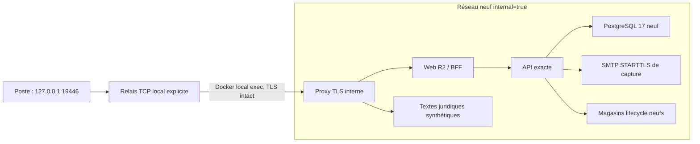

# Docnelo — Architecture du laboratoire d'inscription

Recette locale du 31 octobre 2026, Europe/Paris. Verdict du parcours complet : **BLOCKED**.

Le laboratoire a réellement démarré avec les images API et Web demandées. Il reproduit le refus d'admission de l'API sous garde lifecycle stricte. Il ne qualifie aucune ouverture publique.

## Implantation distincte

- Dossier : `deliveries/docnelo-signup-e2e-lab/`.
- Worktree : `deliveries/docnelo-signup-e2e-lab/source`, HEAD détachée sur `b046e5d8256d45b65bf575a8a006351616b69fc9` (R2), propre en fin de recette.
- Projet Docker : `docnelo-signup-lab-7c98f505cd`.
- Les branches existantes, le worktree lifecycle à 10 et leurs modifications n'ont pas été édités. Aucune nouvelle branche ni commit créé.
- L'API exécutée provient de l'archive privée vérifiée, sans remplacement de son code par celui du worktree.

## Images et intégrité

| Composant | Identifiant immuable utilisé |
| --- | --- |
| API exacte | `sha256:4aa850b6fb8d16b32fd731d94b232b2f817f461892b3f39a28e7557a25a5eb3d` |
| Web R2 | `sha256:ebdbc7fba1c61c03349088ca093470c78eec9dd91c5e2aa92ab1d8c0db5be362` |
| PostgreSQL/vector 17 | `sha256:d2e0a72a9da278610fc926cc8d125827c0069f33feaafa011aae890572ec95c3` |
| Outils SMTP de test | `sha256:526917bd27ecc837a7b683c0ca396fcdf315dde81c879100bffda874a3abeb1d` |
| Proxy TLS Traefik local | `sha256:ff8877338069e690053302ba9a8d8eeb47259467774ea90826f77a32e787a488` |

Toutes les images sont locales, linux/amd64, avec `pull_policy: never`. PostgreSQL a annoncé **17.11** dans le journal du premier démarrage.

`archive-proof.json` établit les empreintes des configurations Docker et des couches non compressées : 15 couches API et 11 couches Web. L'identifiant API correspond à celui fourni par l'utilisateur ; le Web correspond au manifeste R2 préexistant.

| Archive privée | SHA-256 calculé |
| --- | --- |
| `deliveries/docnelo-10-users/api-active.tar` | `2ee6ab4f9a5eee4e6dad475e0a2988745472e12a918e186580a36e2e6c631081` |
| `deliveries/docnelo-web-branding-r2/payload/web-r2.tar` | `de8f742edd34bf0182e746916376599686fcd7d5a176e43cdf0979caa32fc54b` |

L'empreinte d'archive API est une nouvelle mesure locale, sans référence indépendante antérieure. L'empreinte Web correspond à `RELEASE.json`. Cette vérification établit l'identité et l'intégrité des artefacts locaux ; elle n'atteste pas le commit historique de construction de l'API ni l'image actuellement exécutée sur le VPS. Les images auxiliaires ont été identifiées localement, sans nouvelle attestation de leur chaîne de construction.

L'API a été chargée depuis `api-untagged.tar`, copie privée sans tags ni métadonnées de tags OCI. L'archive d'origine et les tags existants ont été préservés.

## Topologie

Les six services permanents partagent uniquement le réseau `docnelo-signup-lab-7c98f505cd_isolated`. Les deux services ponctuels de migration et de provisionnement sont supprimés après exécution. Aucun port Docker n'est publié dans la configuration finale. Aucun réseau existant ou externe n'est référencé. Le relais optionnel écoute exclusivement `127.0.0.1` et rejoint le proxy via l'entrée/sortie d'un `docker exec` local ; les services ne reçoivent aucun accès réseau supplémentaire.

Les volumes `database`, `database_retry`, `documents`, `lifecycle` et `capture`, tous préfixés par le projet, ont été créés pendant cette recette. `database` contient le premier essai d'initialisation interrompu ; seule `database_retry` sert à la recette finale. Aucun volume préalable n'est monté. Les seuls bind mounts sont des fichiers de laboratoire en lecture seule.

## Garde et droit synthétique

Le profil reste `standard`, avec limite **5**, reçus durables obligatoires et mutations synthétiques désactivées. Aucun test n'utilise Beta Lite ou l'API candidate du travail lifecycle à 10. Le quota créé par les migrations reste `issued_count=0, closed=true`.

`PUBLIC_LEGAL_READY=true` sert exclusivement à déclarer les trois textes synthétiques du laboratoire, version `lab-only-v1`, opérateur fictif et adresses `example.test`. Il ne représente aucune approbation des documents réels. Un contrôle distinct vérifie que `PUBLIC_LEGAL_READY=false` bloque toujours la configuration publique.

Les archives juridiques embarquées dans Web R2 sont conservées ; leur version `beta-2026-10-v1` diffère de `lab-only-v1`. Les textes synthétiques sont servis séparément sous `/lab-legal/`. Aucun parcours de consentement graphique à ces textes n'est qualifié : servir le HTML de la SPA ne prouve pas une interaction navigateur réussie.

État final : six conteneurs arrêtés, relais arrêté, volumes synthétiques conservés pour inspection. Voir les trois autres rapports et les preuves JSON dans le dossier de laboratoire.
